<p align="center">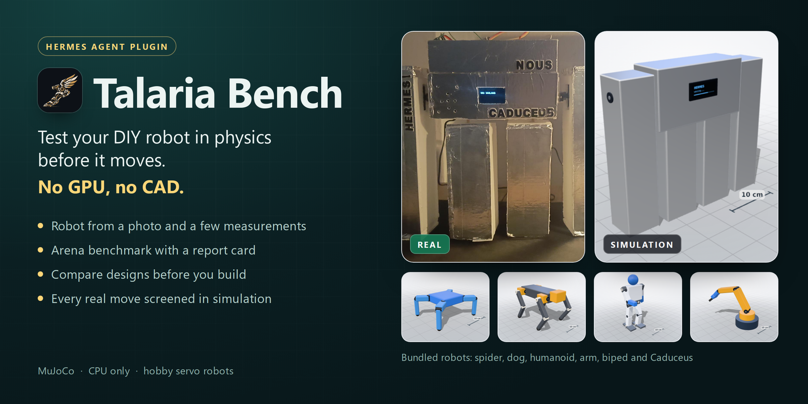</p>

# 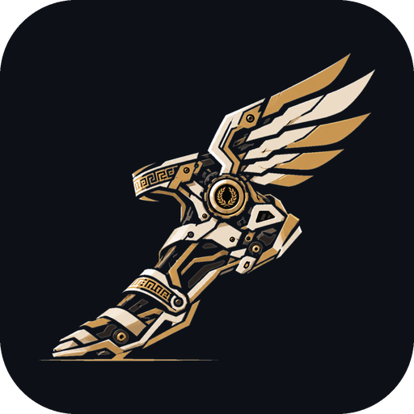 Talaria Bench

[](https://github.com/devorun/talaria-bench/actions/workflows/tests.yml)
[](https://github.com/NousResearch/hermes-agent)

[](LICENSE)

**Talaria Bench tests your DIY robot in physics before it moves. No GPU, no CAD.**

A [Hermes Agent](https://github.com/NousResearch/hermes-agent) plugin for hobby servo robots (SG90, MG90S,
MG996R and friends), built on MuJoCo. In Greek myth, talaria are Hermes's winged sandals: the thing that
makes him move.

- Describe your robot with a photo and a few measurements, and see it in 3D inside Hermes.
- One click: flat ground, ramp, obstacles, push and slippery-floor tests, with a report card that says why it fails.
- Compare design variants (longer legs, stronger servos) before you build or print anything.
- Arena: put a robot and a resized, reweighted or re-servoed version of it on the same ramp, bar or push test and
  watch both side by side in the same world.
- Every move Hermes sends to your real robot is screened in simulation first.

<p align="center">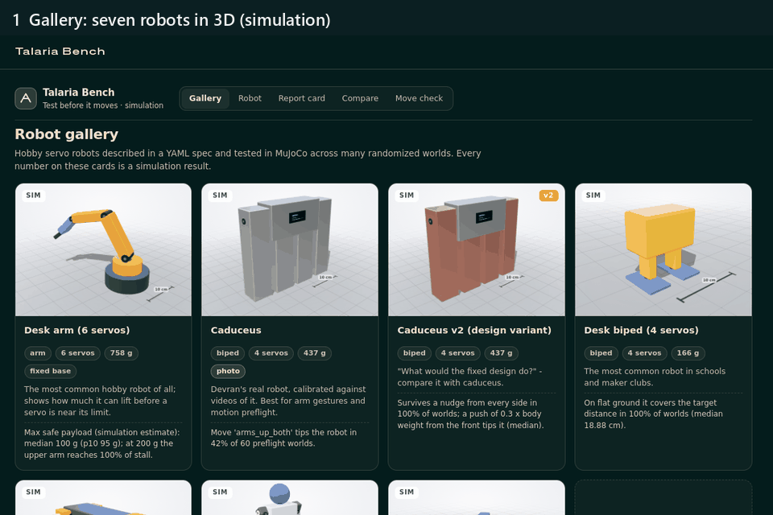</p>
<p align="center"><sub>The Talaria Bench tab in the Hermes web dashboard (simulation).</sub></p>

Every number Talaria Bench shows comes from simulation and is labelled that way. It is
simulation-based risk screening, not a safety guarantee.

## Quick start

```bash
hermes plugins install devorun/talaria-bench --enable --yes-deps
```

This clones the plugin, installs its Python dependencies (`mujoco`, `numpy`, `pyyaml`) into Hermes's
environment and enables it. Without `--yes-deps` Hermes asks before installing them.

- **Hermes Desktop:** Capabilities -> Plugins -> make sure Talaria Bench is enabled, then open the
  **Talaria Bench** page in the sidebar.
- **Web dashboard:** run `hermes dashboard` and open the **Talaria Bench** tab.
- **Chat:** `/talaria demo` gives a tour without hardware: a quick benchmark of the spider, then the
  preflight of two Caduceus moves (one is blocked, one passes) and a play on the virtual robot.
  `/talaria help` lists the other commands; `hermes talaria --help` does the same in a terminal.

Or just ask Hermes: *"Benchmark the spider and tell me where it fails"*, *"Add my robot"* (with a photo),
*"Write a dance for Caduceus and check it"*.

## A two-minute tour

<table>
  <tr>
    <td width="50%">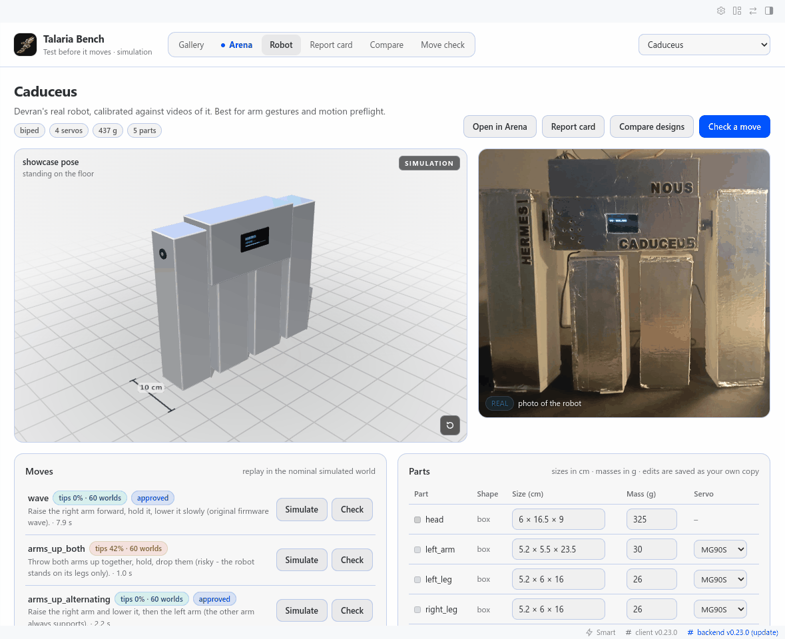<br>
      <sub><b>Your robot in 3D, next to its photo.</b> Hermes Desktop, light theme. Moves replay in simulation.</sub></td>
    <td width="50%">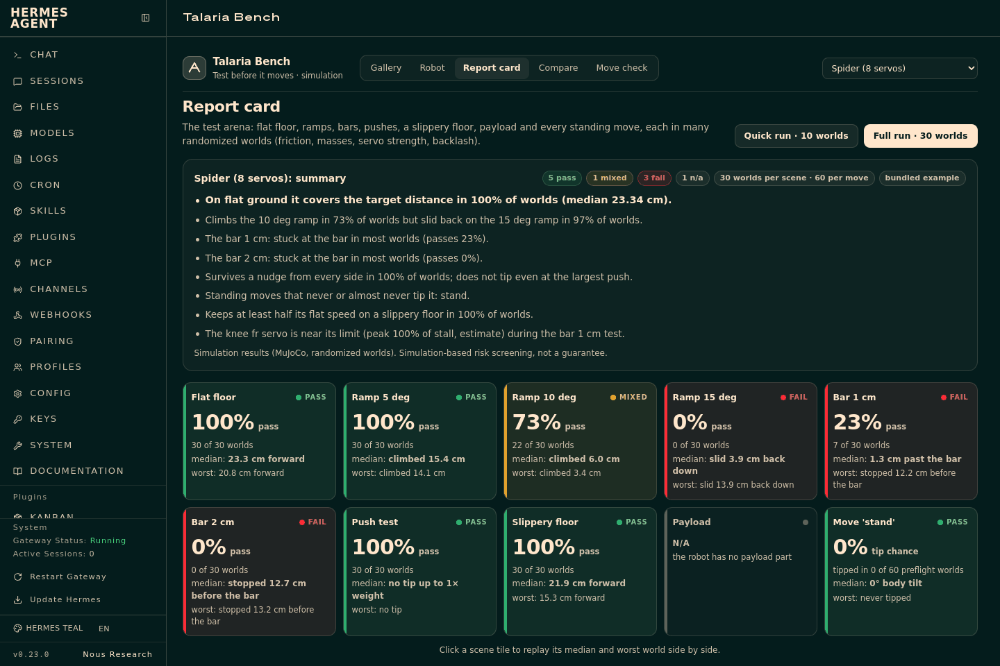<br>
      <sub><b>One click, one report card.</b> A tile per scene: pass rate, median, worst world.</sub></td>
  </tr>
  <tr>
    <td>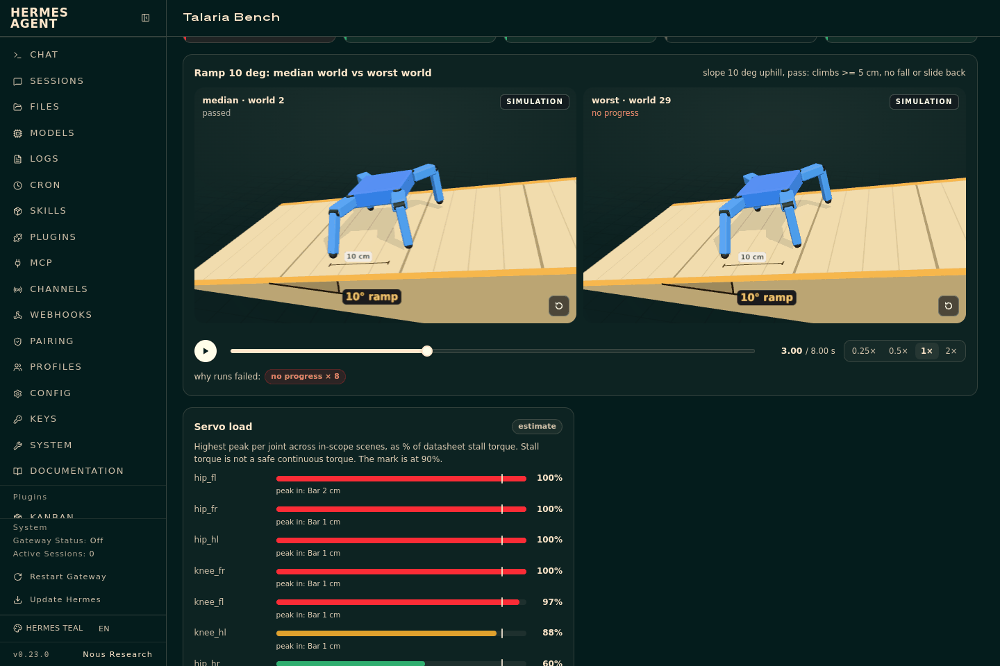<br>
      <sub><b>See why it fails.</b> The median and the worst world replay side by side; the scene shows its own numbers.</sub></td>
    <td>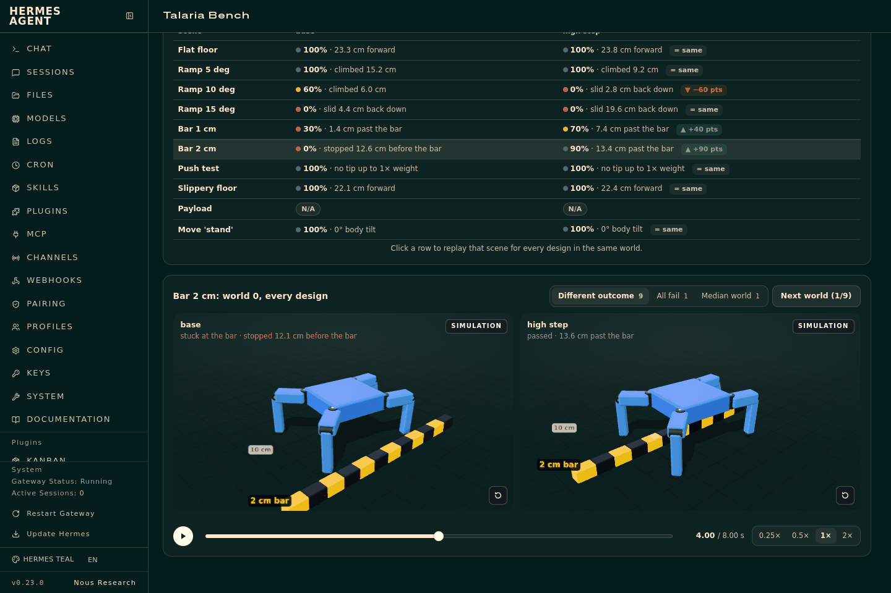<br>
      <sub><b>Compare designs before you build.</b> Variants on the same worlds, with the change in pass rate.</sub></td>
  </tr>
  <tr>
    <td>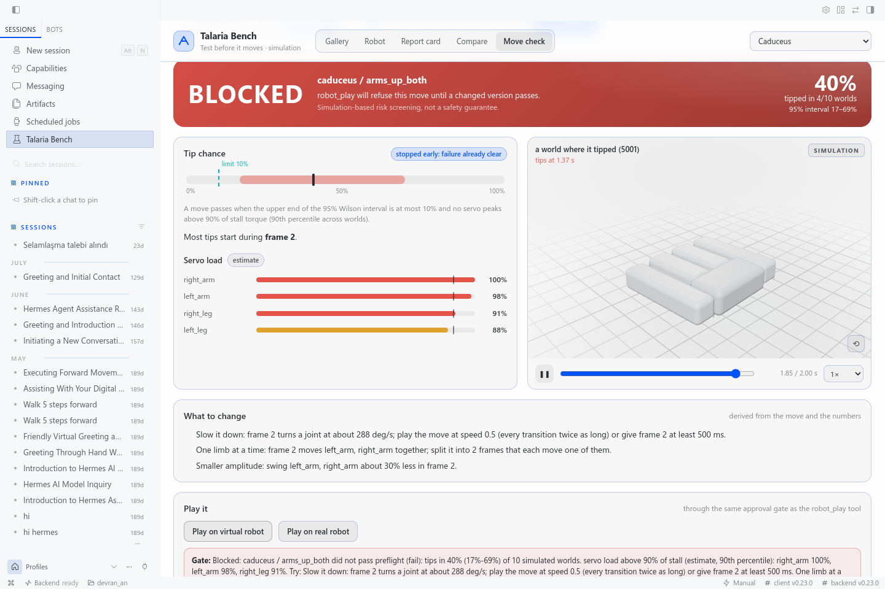<br>
      <sub><b>BLOCKED.</b> The move tips the robot in 25 of 60 simulated worlds; the gate refuses it and says what to change.</sub></td>
    <td>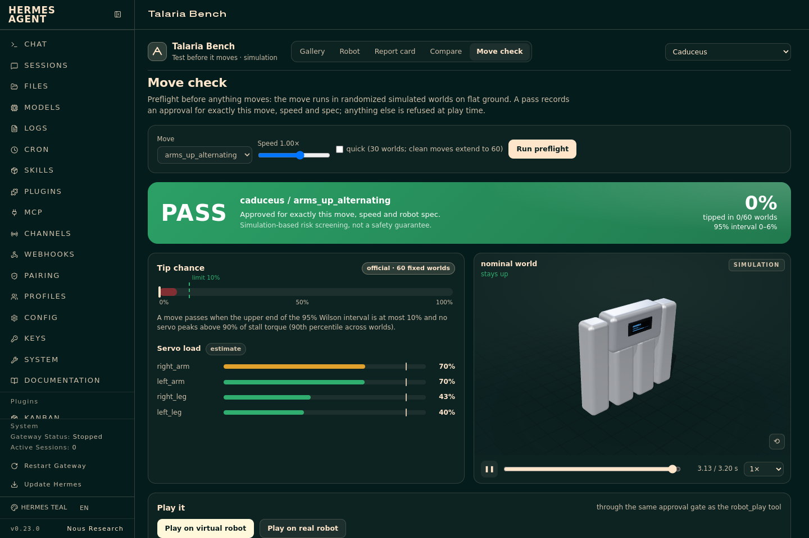<br>
      <sub><b>PASS.</b> The revised move is approved for exactly this move, speed and robot spec.</sub></td>
  </tr>
</table>

## How it works

<p align="center"><picture>
  <source media="(prefers-color-scheme: dark)" srcset="docs/img/diagram-pipeline-dark.svg">
  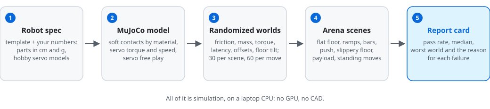
</picture></p>
<p align="center"><sub>From a robot spec to a report card.</sub></p>

<p align="center"><picture>
  <source media="(prefers-color-scheme: dark)" srcset="docs/img/diagram-gate-dark.svg">
  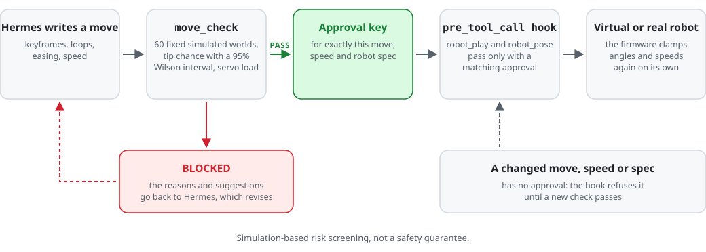
</picture></p>
<p align="center"><sub>The motion gate: only a move that passed its check reaches a robot.</sub></p>

- **Robot spec.** Parts (box, cylinder, sphere), sizes in cm, masses in g, joints with ranges
  and hobby servo models from a small servo catalog. See [docs/robot-spec.md](docs/robot-spec.md).
- **Arena.** Flat floor, ramps of 5, 10 and 15 deg, bars of 1 and 2 cm, a push test (0.05 to 1 x body
  weight from four sides), a slippery floor (foot friction 0.08-0.15), payload steps for arms, and the
  robot's own moves. Each scene runs in 30 randomized worlds by default (10 with `quick`; 10 to 200 on
  request). Benchmarks run as background jobs; a full benchmark of one robot takes about one to two minutes
  on a 4-core laptop CPU.
- **Report card.** GREEN / AMBER / RED per scene with the pass rate, the median and p10 of the scene's
  main metric, the worst world and the top failure reasons. Distances count only steady progress, so a
  one-time lurch earns nothing. Format: [docs/report-format.md](docs/report-format.md).
- **Design comparison.** Up to six variants (`legs +1.5 cm`, another servo, more mass) on the same worlds.
- **Motion preflight.** A move runs in 60 fixed randomized worlds. It passes when the upper end of the
  95% Wilson interval of its tip chance is at most 10% and no servo peaks above 90% of its stall torque
  (90th percentile across worlds). A quick check starts with 30 worlds and extends a clean run to 60; it
  never blocks on fewer than 30. Speed-limit stretches, self and ground collisions are reported too.
- **The gate.** A `pre_tool_call` hook lets `robot_play` and `robot_pose` through only when that exact
  move (frames, loops, easing), speed and robot spec passed. Any change needs a new check.

## Robot gallery

Seven robots ship in `examples/robots/`. Headlines from the arena benchmark (simulation, 30 worlds per
scene; full cards in [examples/reports/](examples/reports/), more in [docs/gallery.md](docs/gallery.md)):

| Simulation&nbsp;render | Robot | Servos | Mass | Benchmark headline (simulation) |
|---|---|---|---|---|
| 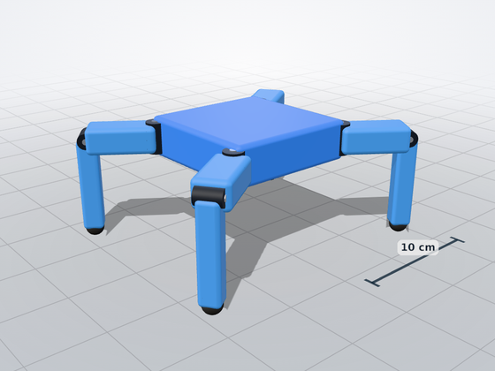 | `spider8` Spider | 8 | 250 g | Covers the flat-ground target distance in 100% of worlds (median 23.3 cm); climbs 10 deg in 73%, slides back on 15 deg. |
| 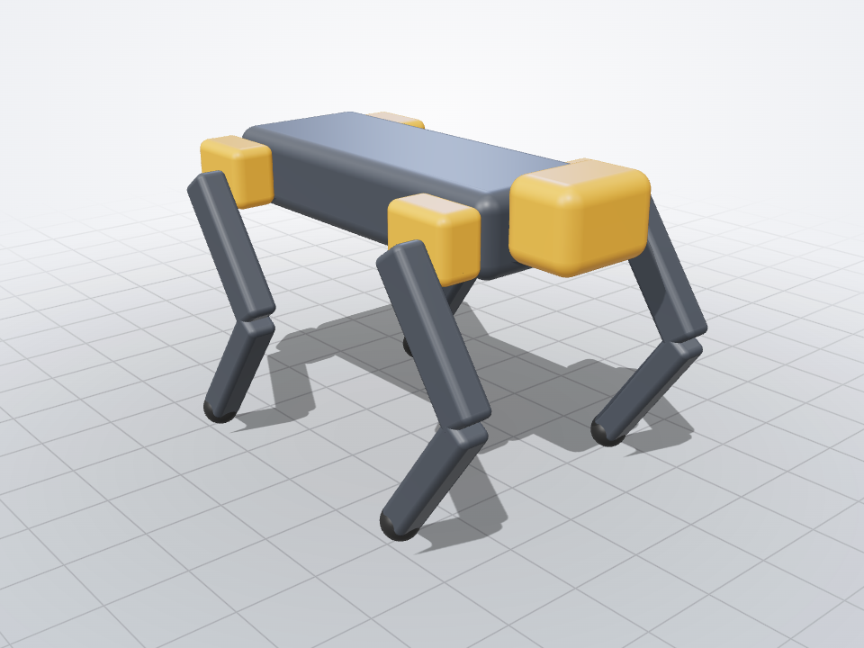 | `dog12` Robot dog | 12 | 1600 g | Trots the flat target in 97% of worlds (median 45.1 cm); on the slippery floor its feet skate. |
| 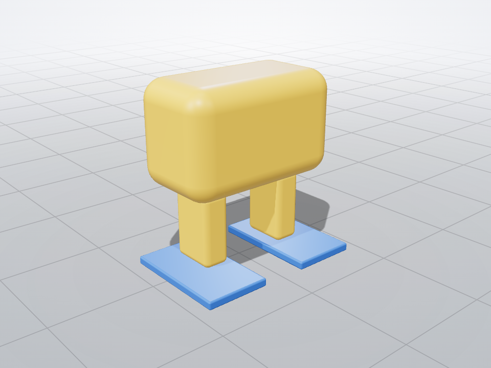 | `desk-biped4` Desk biped | 4 | 166 g | Walks the flat target in 100% of worlds (median 18.9 cm); stuck at both bars. |
| 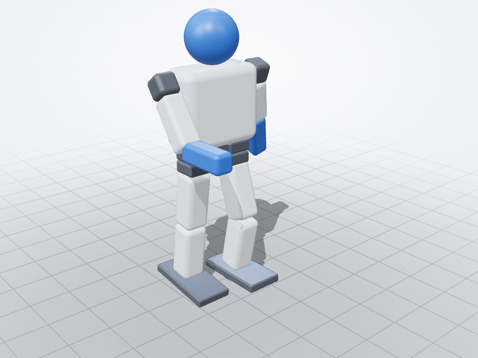 | `humanoid16` Small humanoid | 16 | 802 g | `dance_safe` stays upright; `dance_risky` tips it in 95% of 60 preflight worlds. |
| 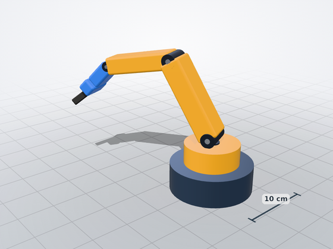 | `arm6` Desk arm (fixed base) | 6 | 758 g | Max safe payload median 100 g (p10 95 g); at 200 g the upper arm reaches stall (estimate). |
| 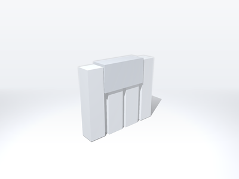 | `caduceus` Caduceus | 4 | 437 g | `arms_up_both` tips it in 42% of 60 preflight worlds; `arms_up_alternating` passes. Walking is out of model scope. |
| 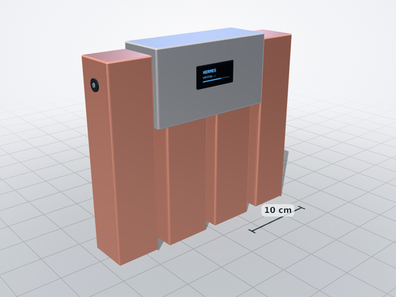 | `caduceus_v2` Caduceus v2 (design variant) | 4 | 437 g | Tighter joints and a lower centre of mass: survives a nudge from every side in 100% of worlds. |

<p align="center">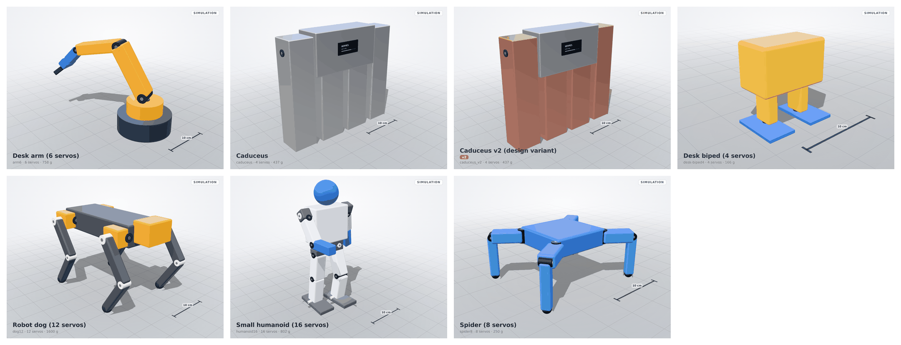</p>
<p align="center"><sub>The seven bundled robots, drawn by the same renderer as the app. The bar on the floor is 10 cm.</sub></p>

## Bring your own robot

- **From a photo, in chat.** Send Hermes a photo and say "add my robot". The bundled `robot-onboarding`
  skill reads the photo for structure only (family, limbs, servos), asks for the three or four
  measurements that matter most, and builds the model from a template. Sizes and masses come from you;
  anything estimated is named as an estimate. The photo is shown next to the 3D model.
- **From a template.** `block_robot` (Caduceus-like), `biped4`, `quadruped` (8 or 12 servos), `hexapod`,
  `arm`, `humanoid`, each with a few numbers. The dashboard has a New robot form for the same templates.
- **From a spec file.** Write the YAML yourself: [docs/robot-spec.md](docs/robot-spec.md). Your robots are
  stored in the plugin data folder; the bundled examples are never modified (edits make your own copy).

## Real hardware

<p align="center"><picture>
  <source media="(prefers-color-scheme: dark)" srcset="docs/img/diagram-hardware-dark.svg">
  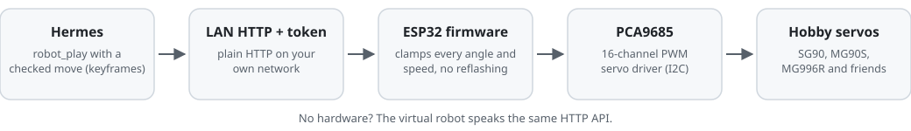
</picture></p>
<p align="center"><sub>The hardware path. Moves travel as data; the firmware never needs reflashing for a new move.</sub></p>

- **Firmware.** `firmware/talaria_robot/` is an ESP32 + PCA9685 sketch. `hermes talaria firmware <robot>
  <folder>` writes the sketch plus a `robot_config.h` generated from the robot spec (I2C pins, servo
  channels, joint ranges, speed limits, home pose, spec hash) and a random 128-bit robot token, and prints the
  `hermes config set TALARIA_ROBOT_TOKEN <token>` line. Copy `secrets.example.h` to `secrets.h`, add your
  Wi-Fi, build with the ESP32 core and the Adafruit PWM Servo Driver and ArduinoJson 7 libraries.
  Moves are sent as data (keyframes) over HTTP, so there is no reflashing per move. The firmware clamps
  every angle to its joint range and stretches every transition to the joint's speed limit on its own.
- **Settings** (Hermes Desktop: Settings -> Plugins -> Talaria Bench, or
  `plugins.entries.talaria-bench.settings`): `robot_url` (for example `http://192.168.1.8`),
  `real_robot` (which spec the robot is), `robot_token` (a Hermes secret, `TALARIA_ROBOT_TOKEN`),
  `timeout_s`, `check_worlds`.
- **What the plugin checks before a real move.** The robot must report the same robot name and joints
  as the checked spec and the same spec hash in its firmware; a robot without a token is refused. Both
  refusals can be turned off explicitly (`allow_firmware_mismatch`, `allow_unauthenticated_robot`, both
  off by default). `robot_stop` and `robot_status` always work.
- **Every move starts from home.** `robot_play` and `robot_pose` first ease the robot back to its home
  pose at half of each joint's speed limit (at least 600 ms) and wait until it is idle there, then play.
  The preflight simulates moves from the home pose, so this keeps the real start pose equal to the
  simulated one. **This return to home is not simulated itself.** It is skipped when the robot already
  stands still at home; a robot that does not reach home in time gets no move. `robot_stop` with
  `home: true` also moves the robot home without a preflight (stop is the safety action).
- **No hardware?** Everything works with the virtual robot: `target: virtual` in chat, the Play buttons
  in the UI, or `hermes talaria sim` for a local virtual robot with the firmware's HTTP API.

## The Caduceus story

Caduceus is Devran's own robot: a foam-board biped with four MG90S servos, two long arms and two short
legs. Its simulation model was calibrated against videos of the real robot, sampling hundreds of
parameter sets (geometry, foam softness, servo play, firmware timing) against what the clips show. That
search found that the original firmware played moves about 2.5 times slower than its code suggests,
because the servo library re-read a register on every write; the Talaria firmware writes the servo
signal directly, so a move plays at the timing it was checked at. Details:
[docs/calibration-caduceus.md](docs/calibration-caduceus.md).

## Scope and assumptions

- Robots are rigid bodies. Soft materials (foam, rubber feet) are approximated with soft contacts, not
  simulated as deforming parts. Where that is not enough, a spec declares a limitation and the report
  card shows those scenes as OUT OF MODEL SCOPE instead of scoring them (Caduceus's walk is one).
- Servo loads are estimates: peak torque as a share of the datasheet stall torque, which is not a safe
  continuous torque. Servo dynamics, gear play, latency and offsets are modelled simply and randomized
  per world.
- All results are simulation. Randomized worlds give a spread, not a guarantee about one real run.
- Preflight screens one move at a time from the home pose; sequences are not screened as a whole (the
  real robot returns home first, see above).
- Out of scope today: learning new gaits, automatic sim-to-real calibration, physics from photos,
  wheels and continuous-rotation servos, sensor feedback (IMU) policies, URDF/MJCF import.

## Security and privacy

What Talaria Bench does on your machine and network:

- **Files.** It writes only inside the plugin data folder Hermes gives it,
  `$HERMES_HOME/plugin-data/talaria-bench/` (outside Hermes: `~/.cache/talaria-bench/`): your robots and
  their photos, saved moves, preflight approvals, benchmark jobs (command, log, progress), reports and
  result caches. The 3D trace cache is not pruned automatically; delete the `cache` folder to free space.
  `hermes talaria firmware` writes the firmware into the folder you name.
- **Reading your files.** `robot_define` with `photo_path` reads one image file (JPEG, PNG or WebP, at
  most 10 MB) that must be under your home folder or the Hermes folder, and copies it into the data
  folder. It reads no other files of yours.
- **Background processes.** Benchmarks and design comparisons run as background Python subprocesses of
  the plugin's own `devcli.py`, each with a worker pool of up to N-1 CPU cores (at most 8). At most two
  jobs run at once, each limited to 10-200 worlds per scene.
- **Local servers.** Playing on the virtual robot starts a small HTTP server on `127.0.0.1` on a random
  port, in the Hermes process, with no token (only local programs can reach it). `hermes talaria sim`
  listens on `127.0.0.1:8765` unless you pass `--host`.
- **Network.** Plain HTTP requests (bypassing HTTP proxies, since the robot is on your local network) go
  only to the `robot_url` you set, and only for `target: real`. The robot token travels unencrypted on
  your LAN. The firmware joins your Wi-Fi, serves HTTP on port 80 and announces itself over mDNS.
- **Credentials.** The only credential is the optional robot token, stored and read through Hermes
  secrets (`TALARIA_ROBOT_TOKEN`). Your Wi-Fi password stays in the firmware's `secrets.h` on your
  machine and is never read by the plugin.
- **No telemetry, no downloads, no shell commands.** Nothing is sent anywhere else, and the plugin never
  updates itself.

## Development

```bash
python -m pip install "mujoco>=3.1.6,<5" "numpy>=1.26,<3" "pyyaml>=6.0,<7" pytest fastapi httpx
python -m pytest -q                  # the full suite
python -m pytest -q -m "not slow"    # what CI runs on every OS
```

- The folder name has a dash, so tests and `devcli.py` load the plugin as the package `talaria_bench`.
  `python devcli.py --help` runs benchmarks, comparisons and calibrations without Hermes.
- UI: one source in `ui/src` builds both the Desktop page (`desktop/plugin.js`) and the dashboard tab
  (`dashboard/dist/index.js`): `cd ui && npm ci && npm run build`. The bundles are committed unminified
  so they can be reviewed.
- CI (`.github/workflows/tests.yml`): pytest on Ubuntu, macOS and Windows with Python 3.11, 3.13 and 3.14,
  plus the full suite with the `spawn` start method.
- `hermes plugins validate . --install-deps` checks the plugin the way the catalog does.
- README media: `scripts/render_gallery.py` (robot renders with the app's renderer), `scripts/ui_screens.py`
  (screenshots through Playwright; use a temporary `HERMES_HOME`), `scripts/readme_media.py` (banner, tour GIF)
  and `scripts/diagrams.py` (the SVG diagrams). They need Playwright and Pillow, which the plugin does not.

Licence: [MIT](LICENSE). The UI bundles include three.js (MIT); see
[THIRD_PARTY_NOTICES.md](THIRD_PARTY_NOTICES.md). MuJoCo (Apache-2.0) is installed as a dependency, not
bundled.
